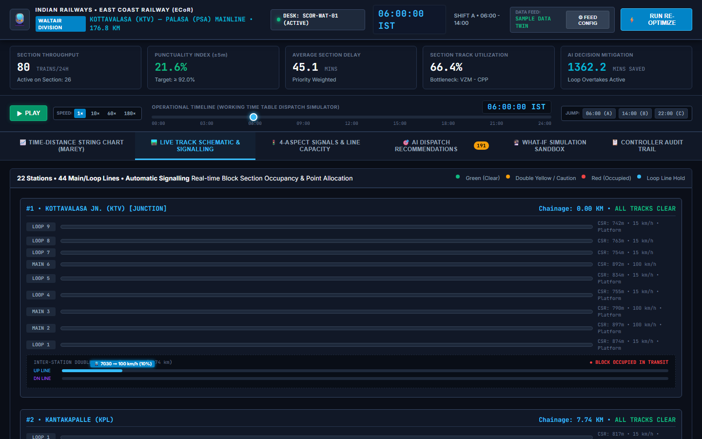
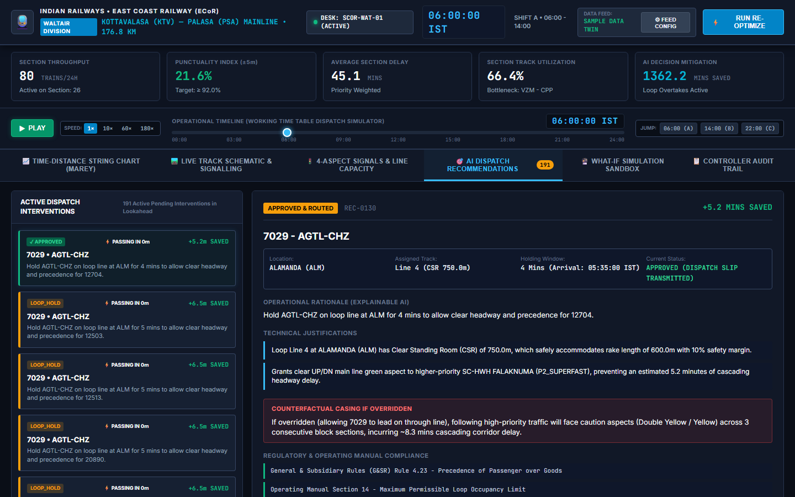
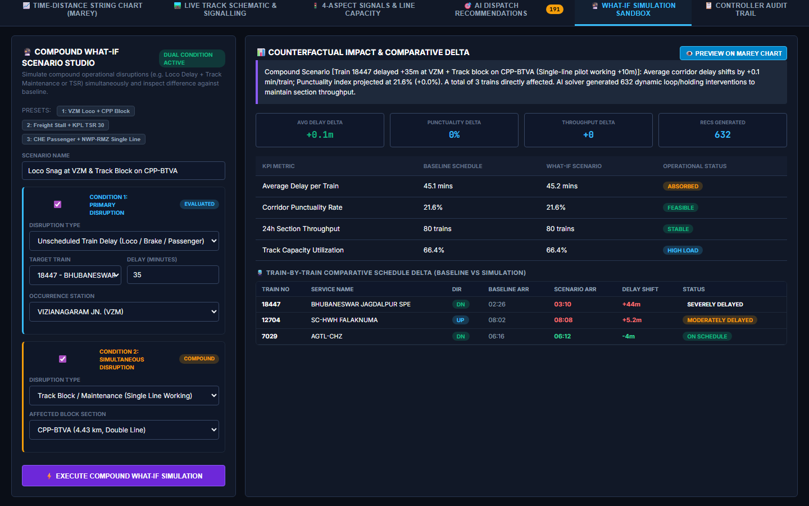
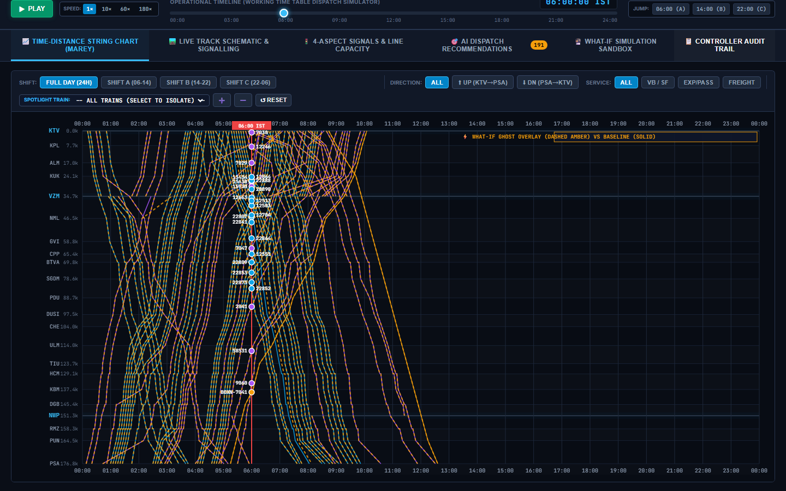

# AI-Integrated Decision Support System (AIDSS)
## Maximizing Section Throughput Using AI-Powered Precise Train Traffic Control

[](https://www.python.org/downloads/)
[](https://fastapi.tiangolo.com)
[](https://developers.google.com/optimization)
[](tests/test_core.py)
[](#corridor-digital-twin)

> **Ministry of Railways, Government of India**  
> **Problem Statement ID**: 25022  
> **Operational Corridor**: Kottavalasa (KTV) to Palasa (PSA) Mainline, Waltair (WAT) Division, East Coast Railway (ECoR)  
> **Corridor Length**: 176.83 km | 22 Stations | Double Line Automatic Block Signalling (ABS)

---

## 1. Problem Overview & Operational Context

Indian Railways' mainline corridors handle heavy mixed-traffic: high-priority passenger services (Vande Bharat, Rajdhani, Superfast Express operating up to 130 km/h) share tracks with heavy freight rakes (BOXN coal and BCN grain rakes operating at 50–75 km/h). 

When unscheduled delays or track maintenance blocks occur, section controllers must make split-second decisions under high stress. Inefficient holding decisions cause cascading headway congestion across block sections, degrade corridor punctuality, and underutilize line capacity.

**AIDSS** is an industrial-grade, mission-critical Decision Support System engineered for Railway Section Controllers (SCOR) and Chief Controllers (CPCR). It combines **Operations Research (Google OR-Tools CP-SAT)**, **fast disjunctive priority heuristics**, **dynamic loop line allocation ($L \le CSR$)**, **compound What-If disruption simulation**, and **Explainable AI (XAI)** compliant with General & Subsidiary Rules (G&SR Rule 4.23).

---

## 2. Corridor Digital Twin Topology

The system models the physical track topology, station loop dimensions, and traffic of the **KTV–PSA mainline corridor**:

| Parameter | Operational Specification |
| :--- | :--- |
| **Span** | 0.00 km (Kottavalasa Jn.) to 176.83 km (Palasa) |
| **Total Stations** | **22 Stations in physical sequence**: `KTV` $\rightarrow$ `KPL` $\rightarrow$ `ALM` $\rightarrow$ `KUK` $\rightarrow$ `VZM` (Junction) $\rightarrow$ `NML` $\rightarrow$ `GVI` $\rightarrow$ `CPP` $\rightarrow$ `BTVA` $\rightarrow$ `SGDM` $\rightarrow$ `PDU` $\rightarrow$ `DUSI` $\rightarrow$ `CHE` $\rightarrow$ `ULM` $\rightarrow$ `TIU` $\rightarrow$ `HCM` $\rightarrow$ `KBM` $\rightarrow$ `DGB` $\rightarrow$ `NWP` (Junction) $\rightarrow$ `RMZ` $\rightarrow$ `PUN` $\rightarrow$ `PSA` |
| **Track Infrastructure** | 103 station lines (UP Main, DN Main, Common Loops), each with measured Clear Standing Room (CSR, e.g. 782m at ALM, 750m at SGDM) and turnout speed limits (15 km/h) |
| **Signalling** | Double Line Automatic Block Signalling (ABS) with 4-aspect colour lights (Green, Double Yellow, Yellow, Red) |
| **Traffic Handled** | 229 passenger services (Vande Bharat, Mail/Express, Passenger) synchronized with heavy freight traffic |

---

## 3. System Screenshots

### Interactive Time-Distance String Chart (Marey Diagram)
*Real-time train trajectories across 22 stations over 24 hours, directional filters (UP/DN), service filters, spotlight train isolation, and real-time playback marker.*


### Dynamic Track Schematic & Station Occupancy
*Linear track schematic showing real-time train positions, station loop dwells, and inter-station block section progression.*


### AI Dispatch Recommendations & Explainable AI (XAI)
*Deep explainability drawer citing Clear Standing Room (CSR) margins, cascading delay prevention, counterfactual risk if overridden, and G&SR Rule 4.23 compliance.*


### Compound What-If Simulation Sandbox
*Simulate 2 compound conditions simultaneously (e.g. Train Delay + Track Block), with comparative KPI deltas and train-by-train delta schedule.*


### Marey Ghost Overlay Preview
*One-click preview overlaying simulated counterfactual paths (dashed amber ghost curves) against active baseline strings (solid curves) directly on the Marey Chart.*


---

## 4. Key Functional Capabilities

### A. Dynamic Recommendation Lifecycle
* **Section-Aware Pruning**: As time progresses or as the controller scrubs the Working Time Table (WTT), recommendations for sections the train has already passed are automatically marked `EXPIRED` and pruned from the active queue.
* **Countdown & Urgency Tiers**: Actionable recommendations within the lookahead window show live countdowns (`⚡ PASSING IN 12m` vs `APPROACHING IN 35m`).
* **Instant Schedule Mutation upon Approval**:
  * Diverts the target train to the station's loop line (e.g. `Line 4 Loop`).
  * Extends dwell time by the hold duration to allow through traffic to overtake.
  * Clears the mainline with green aspects for the following high-priority train, eliminating headway delay.
  * Real-time ripple effect: Marey Chart, Track Schematic, live KPIs, and audit trail update immediately.

### B. Compound Multi-Condition What-If Simulation
* **Simultaneous Disruption Evaluation**: Test two conditions at the same time:
  * *Condition 1 (Primary)*: Train Delay (mins at station) / Track Block / Temporary Speed Restriction (TSR).
  * *Condition 2 (Secondary)*: Simultaneous Track Block / TSR Caution Order / Secondary Train Delay.
* **Controller Presets**:
  * *Preset 1*: Loco Snag at VZM (+35m) & Track Block on `CPP-BTVA`
  * *Preset 2*: Talcher Coal BOXN Delay at KPL (+40m) & TSR 30 km/h Caution Order at GVI
  * *Preset 3*: CHE Passenger Overhaul (+25m) & Single-Line Working on `NWP-RMZ`
* **Comparative Diff Viewer**:
  * KPI comparison table (Baseline vs Scenario).
  * Detailed **Train-by-Train Comparative Schedule Delta** table (train number, service name, baseline arrival, simulated arrival, delay shift, and operational status).
  * Ghost trajectory overlay on the Marey Chart.

### C. 4-Aspect Colour-Light Signalling & Scott's Line Capacity
* Simulates 44 automatic colour-light signals (Home, Starter, Advanced Starter for UP & DN) across all 22 stations based on dynamic headway spacing.
* Calculates **Scott's Line Capacity formula**:
  $$C = \frac{1440}{T + t} \times E$$
  * $T$: Section running time on the critical bottleneck block section (`VZM-CPP`, 11.7 km)
  * $t$: Block clearance & operation time (5.0 min)
  * $E$: Operating efficiency factor (80% per Railway Operating Manual)

### D. Standby Live TMS Adapter ("Ready for Real Data")
* Decoupled `BaseDataSource` interface.
* **Sample Data Mode**: In-memory digital twin caching `Sample Data/` Excel/CSV files.
* **Live TMS Gateway Mode**: Field-ready REST/WebSocket client ready to connect to Indian Railways' Control Office Application (COA), Train Management System (TMS), and FOIS.

---

## 5. Repository Structure

```
AIDSS/
├── backend/
│   ├── config.py                 # System configuration, corridor constants, port 8050
│   ├── domain/
│   │   └── models.py             # Pydantic models (Station, Line, Train, Conflict, Recommendation)
│   ├── adapters/
│   │   ├── base.py               # Abstract BaseDataSource interface
│   │   ├── sample_data_adapter.py# Offline twin (Excel/CSV parser & fast monotonic cache)
│   │   └── live_tms_adapter.py   # Standby live TMS/COA client with health checks
│   ├── engine/
│   │   ├── network.py            # Corridor graph, CSR feasibility ($L \le CSR$), conflict detection
│   │   ├── solver.py             # OR-Tools CP-SAT + fast priority-dispatch heuristic (< 25 ms)
│   │   ├── simulator.py          # Compound What-If simulation engine with train diff calculations
│   │   ├── explainability.py     # XAI engine (G&SR Rule 4.23, CSR math, cascading risk)
│   │   ├── audit.py              # Immutable decision audit log
│   │   └── signalling.py         # Scott's Line Capacity & 4-aspect signal simulator
│   └── api/
│       └── main.py               # FastAPI application serving REST endpoints & static frontend
├── frontend/
│   ├── index.html                # Railway Controller Command Console
│   ├── css/style.css             # Dark industrial command center styling
│   └── js/
│       ├── app.js                # State orchestrator, scrubber sync & API connector
│       ├── marey_chart.js        # Vector HTML5 Canvas Marey diagram with ghost overlay
│       └── track_schematic.js    # Dynamic station loop & block section visualizer
├── docs/
│   └── screenshots/              # Console screenshots for documentation
├── tests/
│   ├── test_core.py              # 9 automated self-checking verification tests
│   ├── test_api_approval.py      # E2E test verifying recommendation approval schedule mutation
│   └── test_browser_e2e.py       # Playwright browser verification suite (0 console errors)
├── Sample Data/                  # Official Ministry of Railways corridor datasets
├── requirements.txt              # Production dependencies
├── run.py                        # Single-command application launcher
└── README.md                     # Documentation
```

---

## 6. Getting Started

### Prerequisites
* Python 3.10 or higher
* Modern web browser (Chrome, Edge, Firefox)

### Installation
1. Clone the repository:
   ```bash
   git clone https://github.com/<your-username>/AIDSS.git
   cd AIDSS
   ```

2. Install dependencies:
   ```bash
   pip install -r requirements.txt
   ```

3. (Optional, for headless browser tests):
   ```bash
   playwright install chromium
   ```

---

## 7. Running the System

Start the server using the single launcher script:
```bash
python run.py
```

Once started, access the console:
* **Controller Web Console**: [http://127.0.0.1:8050](http://127.0.0.1:8050)
* **Interactive API Documentation (Swagger)**: [http://127.0.0.1:8050/docs](http://127.0.0.1:8050/docs)

---

## 8. Verification & Automated Tests

Run the core verification suite:
```bash
python tests/test_core.py
```
*Executes all 9 automated verification checks (adapter ingestion, network topology, OR-Tools optimization, compound simulation, explainability, TMS health check, Scott's capacity, dynamic recommendation lifecycle, and loop schedule mutation).*

Run the headless browser test:
```bash
python tests/test_browser_e2e.py
```
*Launches headless Chromium, validates chart rendering, tab switching, What-If simulation execution, and confirms 0 JavaScript errors.*

---

## 9. API Reference Summary

| Endpoint | Method | Description |
| :--- | :---: | :--- |
| `/api/status` | `GET` | System health, active adapter mode, corridor metadata |
| `/api/infrastructure` | `GET` | 22 stations, CSR lengths, speed limits, block sections |
| `/api/trains/active` | `GET` | Active train schedules across corridor |
| `/api/trains/positions` | `GET` | Real-time train positions & speeds at given operational second |
| `/api/recommendations` | `GET` | Dynamic active recommendations (supports `?time_sec=` filtering) |
| `/api/decisions/action` | `POST` | Approves or overrides recommendations, mutates active schedule |
| `/api/simulate` | `POST` | Executes compound What-If simulation across 1 or 2+ conditions |
| `/api/signalling/aspects`| `GET` | Live 4-aspect signal states for UP & DN lines across all stations |
| `/api/analytics/capacity`| `GET` | Scott's Line Capacity, critical block section, saturation index |
| `/api/audit` | `GET` | Immutable controller audit records with override justifications |
| `/api/datasource/switch` | `POST` | Switches between `sample` digital twin and `live_tms` gateway |

---

## 10. Compliance & Standards

* **General & Subsidiary Rules (G&SR)**: Rule 4.23 (Precedence of Passenger traffic over Freight).
* **Operating Manual**: Section 14 (Clear Standing Room & Maximum Loop Occupancy).
* **Signal Engineering Manual (SEM)**: Absolute and Automatic Block Signalling clearance criteria.
* **Digital Logging Standard**: COA/TMS controller audit compatibility with mandatory override reasons.
