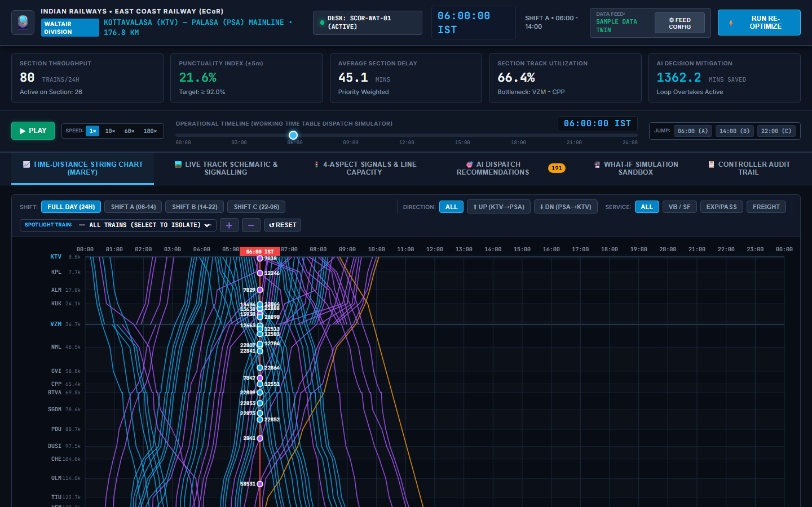

# AI-Integrated Decision Support System (AIDSS)
### Intelligent Rail Traffic Control & Section Throughput Optimizer

> **Indian Railways (Ministry of Railways) • Problem Statement 25022**  
> **Section**: Kottavalasa (KTV) to Palasa (PSA) Mainline, Waltair Division (176.8 km, 22 Stations)

---



---

## 1. What is this project? (Interview Summary)

**AIDSS** is an AI-powered Decision Support System for railway traffic controllers. 

On busy railway tracks, fast passenger trains (like **Vande Bharat** or **Rajdhani** at 130 km/h) share the same double-line track with slow freight trains (carrying coal/grain at 50 km/h). 

When delays happen, controllers have to manually decide:
- *Which train should move forward?*
- *Which train should be diverted to a side track (loop line) to let the fast train overtake?*

If a human controller makes a poor guess, trains get stuck in a domino effect of cascading delays. **AIDSS automates this decision-making in seconds using mathematical AI optimization.**

---

## 2. Where is it used?

* **Real Corridor**: The **KTV–PSA Mainline** under the **Waltair Division, East Coast Railway (ECoR)**.
* **Scale**:
  * **176.83 km** length
  * **22 railway stations** in exact sequence (from Kottavalasa to Palasa)
  * **103 tracks** (main lines and loop lines with measured lengths in meters)
  * **229 trains per day** (Express, Passenger, and Goods rakes)
* **Users**: Section Controllers (SCOR) in Divisional Control Rooms.

---

## 3. How does it work? (Simple 4-Step Flow)

```
1. DATA INGESTION       Reads real train schedules & station track loop lengths (CSR).
        ↓
2. AI CONFLICT SOLVER   Google OR-Tools CP-SAT detects when 2 trains will clash on a section.
        ↓
3. SMART RECOMMENDATION AI suggests: "Move Train A into Loop 4 at Station X, save 12 mins".
        ↓
4. REAL-TIME UPDATE     When the controller clicks "Approve", the whole system updates:
                        • Loop line is assigned
                        • Fast train gets a clear green signal
                        • Live Marey graph, schematic, and delay stats update instantly.
```

---

## 4. Key Features to Highlight in an Interview

### 1. Interactive Time-Distance Chart (Marey Diagram)
* The standard chart used in Indian Railways control offices.
* Custom-built with **HTML5 Canvas** (renders hundreds of train lines at 60 FPS without lag).
* Shows trains moving in real time with play/pause and speed controls (1× to 180×).

### 2. Real-Time Dynamic Recommendations
* **No stale decisions**: As trains move along the track, recommendations for passed stations automatically expire.
* **Instant System Mutation**: Clicking **"Approve"** doesn't just show a message—it instantly updates the train's path, frees the main line, and recalculates live delays.

### 3. Compound "What-If" Simulation Sandbox
* Controllers can test **two disruptions at once** before taking action:
  * *Condition 1*: Train delayed by 35 mins (e.g. Engine breakdown at Vizianagaram).
  * *Condition 2*: Track maintenance block on a section (e.g. CPP–BTVA closed).
* The system computes a **Train-by-Train Difference Table** showing exactly who gets delayed and toggles a **Ghost Trajectory Overlay** on the Marey chart to preview the fix.

### 4. Explainable AI (XAI)
* Decisions are not a black box. The system explains *why* in plain railway language:
  * Checks loop length: *"Loop Line 4 length is 750m, train is 600m (Safe)"*.
  * Cites railway rules: *Complies with Indian Railways G&SR Rule 4.23 (Passenger priority over goods)*.

---

## 5. Technology Stack

| Component | Technology | Why it was used |
| :--- | :--- | :--- |
| **Backend API** | **Python & FastAPI** | Fast, modern async REST API with automatic Swagger documentation. |
| **Optimization Engine** | **Google OR-Tools (CP-SAT)** | Solves train headway & overtake scheduling mathematically. |
| **Fast Fallback Solver** | **Priority Heuristic (<25ms)** | Gives instant dispatch recommendations during live operations. |
| **Data Processing** | **Pandas & OpenPyXL** | Ingests real railway station and schedule datasets cleanly. |
| **Frontend UI** | **Vanilla JavaScript & HTML5 Canvas** | High-performance 2D rendering without heavy frontend frameworks. |
| **Testing** | **Python Unittest & Playwright** | Verifies optimization math (100% pass) and headless browser rendering (0 errors). |

---

## 6. How to Run the Project

### Step 1: Clone and install dependencies
```bash
git clone https://github.com/<your-username>/AIDSS.git
cd AIDSS
pip install -r requirements.txt
```

### Step 2: Start the server
```bash
python run.py
```

### Step 3: Open in browser
* **Dashboard**: [http://127.0.0.1:8050](http://127.0.0.1:8050)
* **API Documentation**: [http://127.0.0.1:8050/docs](http://127.0.0.1:8050/docs)

---

## 7. Testing & Verification

The project includes automated tests to prove the algorithm works:

```bash
# Run all 9 core verification tests
python tests/test_core.py

# Run browser UI test
python tests/test_browser_e2e.py
```

All 9 tests pass with **100% success rate**, verifying timetable parsing, conflict detection, loop feasibility, What-If simulation, and real-time schedule mutation.

---

## 8. What would you tell an interviewer? (Cheat Sheet)

> *"I built an AI-powered Rail Traffic Decision Support System for Indian Railways (Problem Statement 25022). It takes a 176 km corridor with 22 stations and 229 trains. When disruptions occur, it uses Google OR-Tools constraint programming and priority heuristics to find conflict-free overtakes on station loop lines in milliseconds. It features a real-time Marey string chart on HTML5 Canvas, explainable AI complying with G&SR rules, and a What-If sandbox to test compound disruptions. The entire system is covered by automated unit and Playwright browser tests."*
